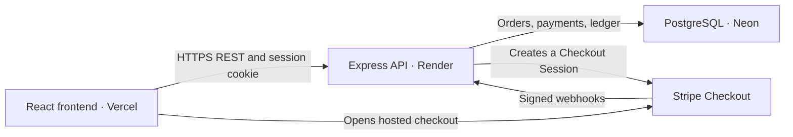

# Credit Wallet — Stripe Payment Lab

A full-stack demo for purchasing app credits with Stripe Checkout and tracking them in a personal wallet. The project focuses on payment processing, transactional credit fulfillment, and a balance derived from a PostgreSQL ledger.

## Live Demo

**[Open Credit Wallet](https://credit-wallet.vercel.app/)** · **[API health](https://credit-wallet.onrender.com/api/health)**

## Features

- Create an account and sign in with an email and password.
- Browse credit packs, including a welcome offer available before the first paid order.
- Buy credits through hosted Stripe Checkout.
- See the current balance and browse paginated wallet activity.
- Return from checkout and refresh the wallet while the payment confirmation is processed.

## Architecture



| Layer | Technologies |
| --- | --- |
| Frontend | React, TypeScript, Vite, Tailwind CSS |
| Backend | Node.js, Express, TypeScript, Better Auth |
| Data | PostgreSQL, SQL migrations, `pg` |
| Payments | Stripe Checkout, signed webhooks |
| Testing and delivery | Vitest, Supertest, Docker, GitHub Actions |

## How a purchase becomes credits

1. The browser submits a product ID. The API checks eligibility, reads the price and credit amount from PostgreSQL, creates an order, and opens a Stripe Checkout session.
2. Stripe sends a signed `checkout.session.completed` event. The API verifies the signature, checks that the session is paid in EUR, and matches the amount to the stored payment.
3. In one database transaction, the API marks the payment and order as paid and adds an `IN` entry to the wallet ledger. Repeated delivery does not add duplicate credits. The ledger enforces a unique entry per credited order.
4. The wallet reads the updated balance and activity from the API. The browser's return from Stripe only tells the UI to refresh. If Stripe reports that a pending session expired, the API marks the order expired and the payment failed.

The balance is computed from ledger entries as **credits in − credits out**. Each entry records the user, amount, direction, timestamp, and associated order when applicable. This makes the balance traceable to the activity the user sees.

## API

| Method and route | Purpose |
| --- | --- |
| `/api/auth/*` | Better Auth routes for registration, session management, and logout |
| `GET /api/products` | List credit packs available to the signed-in user |
| `POST /api/orders` | Create an order from a product ID and return its Checkout URL |
| `GET /api/wallet/balance` | Read the current credit balance |
| `GET /api/wallet/transactions?page=1` | Read a page of wallet activity |
| `POST /api/webhooks/stripe` | Receive signed Stripe events |
| `GET /api/health` | Check whether the API is responding |

## Testing and CI

[GitHub Actions](.github/workflows/ci.yml) runs on pull requests targeting `main` and pushes to `main`. The two jobs run independently.

| Job | Checks |
| --- | --- |
| Backend | Install dependencies, migrate a separate PostgreSQL 17 database, run Vitest and Supertest, compile TypeScript, and build the Docker image |
| Frontend | Install dependencies, type-check, and build with Vite |

Backend integration tests cover order creation and validation, Stripe webhook processing, and payment transaction safety. [Test files](backend/tests/)

## Run locally

Use Node.js 22.12+ and PostgreSQL. Create a local database and apply the [SQL migrations](backend/db/migrations/) in filename order. The catalog reads from the `products` table. Add product records to your local development database to try checkout.

Create `backend/.env` with your local values:

| Variable | Local value |
| --- | --- |
| `PG_STRING` | Connection string for the development database |
| `BETTER_AUTH_URL` | `http://localhost:2111` |
| `BETTER_AUTH_SECRET` | A strong secret for your local environment |
| `CLIENT_URL` | `http://localhost:5173` |
| `STRIPE_SECRET_KEY` | Stripe test-mode secret key |
| `WEBHOOK_SECRET` | Signing secret printed by the local Stripe listener when testing payments |

Run the backend and frontend in separate terminals from the repository root:

```sh
cd backend
npm ci
npm run dev
```

```sh
cd frontend
npm ci
npm run dev
```

Open http://localhost:5173. For local payment testing, run `stripe listen --forward-to localhost:2111/api/webhooks/stripe` and set `WEBHOOK_SECRET` before starting the backend.

## Deployment

The frontend runs on **Vercel**, the API runs on **Render**, and PostgreSQL is hosted on **Neon**.

- **Vercel:** Set the root directory to `frontend`, select the Vite preset, and publish `dist` after running `npm run build`. Set `VITE_API_URL` to the Render API origin before building. In **CDN → Project-level Routing**, rewrite `/payment/success` and `/payment/cancel` to `/index.html`.
- **Render:** Set `CLIENT_URL` to the Vercel frontend origin and `BETTER_AUTH_URL` to the Render API origin. Use the other backend variables from the local setup with their deployment values. Set both origins without paths.
- **Stripe:** Send `checkout.session.completed` and `checkout.session.expired` to the deployed API at `/api/webhooks/stripe`. Set `WEBHOOK_SECRET` to that endpoint's signing secret.

The default Vercel and Render domains are cross-site. For browsers that block third-party session cookies, use HTTPS subdomains of a shared custom domain.

## Project Structure

```text
credit-wallet/
├── .github/workflows/ci.yml
├── backend/
│   ├── db/migrations/
│   ├── src/
│   ├── tests/
│   ├── Dockerfile
│   └── docker-compose.test.yml
├── frontend/
│   ├── src/
│   │   ├── api/
│   │   ├── components/
│   │   └── types/
│   └── vite.config.ts
└── README.md
```

## Author

**Taras Poiatsyka**

[GitHub](https://github.com/tvsxar) · [Portfolio](https://taras-portfolio-theta.vercel.app)
